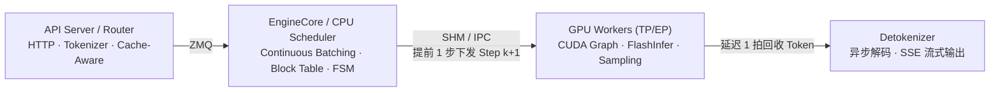
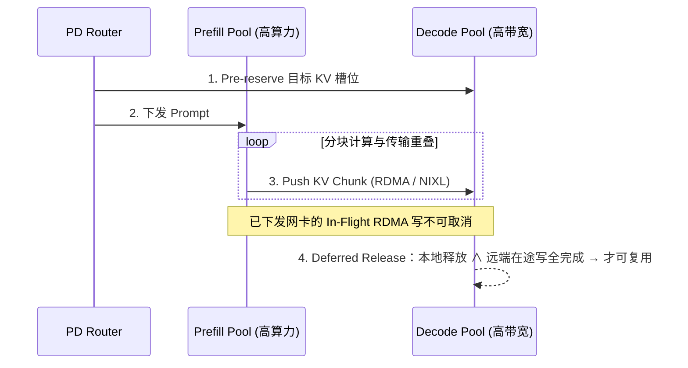

# 曦望（Sunrise）二面 · 大模型推理引擎研发工程师作战手册

> **面试时间**：2026 年 11 月 23 日 15:00（北京时间）｜**公司**：曦望（上海阵量智能科技有限公司）｜**本页为单页无跳转完整版**，直接向下滚动或点击右侧目录平滑定位。

---

## 一、一面复盘排雷（明天必须彻底补齐的 4 个硬伤）

回顾 2026-11-13 一面录音，面试官非常友善且直接点出了你在底层概念和实操定位上的 4 个薄弱点。二面技术负责人/业务面极可能顺着一面评语复查这些点，**每一条都必须能脱口而出**。

### 1.1 排雷 1：GEMM 矩阵分块（Tiling）的硬件本质

- **一面失分点**：回答成了「Transformer 矩阵多，分块提高并行度」，面试官明确反馈「第一个问题没答出来导致后面不好问」。
- **标准满分答法（30 秒直击本质）**：
  - **核心目的不是提高并行度，而是利用片上 Shared Memory / Registers 做数据复用（Data Reuse），大幅减少对慢速 Global Memory（HBM）的重复搬运，从而提高算术强度（Arithmetic Intensity）**。
  - 量化推导：计算 $C = A \times B$（$A \in \mathbb{R}^{M \times K}, B \in \mathbb{R}^{K \times N}$），总计算量 $2MNK$ FLOPs。
    - **不分块**：计算 $C$ 的每个元素都要读 $A$ 的一行（$K$）和 $B$ 的一列（$K$），总 HBM 访存量高达 $2MNK$ 个元素，算术强度仅 $\approx 1$（严重 Memory-bound）。
    - **分块（$B_M \times B_N \times B_K$）**：每个 CTA 负责输出 $B_M \times B_N$ 的 Tile，沿 $K$ 维每次把 $A$ 的 $B_M \times B_K$ 块和 $B$ 的 $B_K \times B_N$ 块搬入片上 Shared Memory。在片上计算外积时，**$A$ 块中每个元素被复用 $B_N$ 次，$B$ 块中每个元素被复用 $B_M$ 次**。
    - **访存压缩比**：总 HBM 访存量降至 $MNK \left(\frac{1}{B_N} + \frac{1}{B_M}\right)$，相比不分块直接压缩约 **$\frac{B_M B_N}{B_M + B_N}$ 倍**（如 $B_M = B_N = 128$ 时访存直降 **64 倍**）。

### 1.2 排雷 2：Nsight Systems（`nsys`）实战判读与 `NVTX`

- **一面失分点**：① 把 `nsys stats` 指标答成了 TTFT/TPOT；② 没用过 `NVTX`；③ 把「GPU 紧密跑 Kernel + CPU 长 `Sync` + `Memcpy`」误判成 CPU 传 GPU 太慢。
- **标准满分答法**：
  1. **`nsys` vs. `ncu` 分工**：`nsys` 看**系统级时间线**（CPU 线程、CUDA API、Kernel、Memcpy、Stream 依赖、NCCL 通信），回答「端到端时间花在哪、GPU 为什么空转」；`ncu` 看**单个 Kernel 微架构指标**（SM/Tensor Core 吞吐、HBM 带宽、L2 命中率、Warp Stall、Register/SMEM 占用），回答「单个 Kernel 为什么慢」。
  2. **`nsys stats` 最常用的 3 张汇总表**：
     - `cuda_gpu_kern_sum`：各 GPU Kernel 的总耗时占比（Time%）、调用次数（Instances）、平均/最小/最大耗时；
     - `cuda_api_sum`：CPU 侧 CUDA Runtime/Driver API 耗时（重点盯 `cudaStreamSynchronize`、`cudaLaunchKernel`、`cudaMemcpyAsync`）；
     - `cuda_gpu_mem_time_sum`：H2D / D2H / D2D 内存拷贝耗时与传输量。
  3. **`NVTX`（NVIDIA Tools Extension）的作用**：在 Python/C++ 代码里通过 `torch.cuda.nvtx.range("prefill")` 或 `nvtx.range_push/pop` 给业务阶段打标签，让 `nsys` 时间线把底层成百上千个零碎 Kernel 和高层框架阶段（Scheduler / Prefill / Decode / Sampling）一一对应起来。
  4. **经典时间线判读（一面原题复盘）**：
     - **现象 A（一面原题）**：GPU 上 Kernel A / B 紧密交替跑（几乎无空隙），同时 CPU 有一条长长的 `cudaStreamSynchronize`，紧接着一段 `Memcpy(D2H)`。
       - **正确结论**：**这是典型的 GPU-bound（计算满载）下的同步等待**——CPU 早已异步把 Kernel 全发射进队列，停在 `Sync` 上干等 GPU 算完才能把结果（如 Decode 采样后的 token_id）拷回 Host。解决同步阻塞的办法是 **Zero-Overhead Overlap Scheduling**（提前发射下一步，延迟一拍回收结果）。
     - **现象 B（反例对比）**：GPU 上 Kernel 之间出现大量白色空洞（Bubbles），CPU 线程持续满载跑 Python 逻辑与高频 `cudaLaunchKernel`。
       - **正确结论**：**这是 CPU-bound / Launch-bound**，解法是 **CUDA Graph**（消除单步 Launch 开销）+ 算子融合 + 多进程解耦控制面。

### 1.3 排雷 3：性能基准指标（Min vs. Median vs. P99）

- **一面失分点**：面试官追问「衡量单个 Kernel / Task 在理想无干扰下的确定性耗时，为什么不用中位数？最理想指标是什么？」未能答出「最小值」。
- **标准满分答法（分层口径）**：
  - **底层算子 / 单 Kernel 物理下界看 `Min`（最小值）**：系统噪声、OS 调度、频率波动只会**增加**耗时，不可能把硬件算得比物理极限更快；因此 `Min` 最接近无干扰理想执行时间。
  - **端到端 A/B 实验稳健对比看 `Median` + `IQR`（配合交错 A/B 与 AA 校验）**：过滤偶发环境毛刺，同时验证两组基线方差可控（如 GraphBudget 的 5 组交错 A/B）。
  - **线上服务用户体验（SLA）看 `P95 / P99` 尾延迟**：真实用户会被长尾请求拖慢，不能只报中位数掩盖长尾抖动。
  - **测量纪律**：必须做 Warmup、锁 GPU 频率（或记录频率）、计时前后加 `torch.cuda.synchronize()`，避免只测到异步 Enqueue 耗时。

### 1.4 排雷 4：自我介绍与实习出勤沟通

- **自我介绍补齐专业技能（60 秒精炼版）**：
  > 「面试官您好，我是哈尔滨工程大学电子信息工程 28 届本科生喻嘉城，技术栈以 Python / C++、Triton 算子开发、CUDA 执行模型与 SGLang / llama.cpp 推理运行时为主。近期主要有三块硬核产出：第一是自研 `GraphBudget`，基于 trace 定位并优化 SGLang BF16 小 M GEMM，在 16 并发下把确定性 Decode 有效输出吞吐提升 72.4%；第二是在 FlagOS 第二季 SGLang 算子赛中，AWQ 4-bit 反量化拿了第 2 名（平台平均 29.46×、昆仑芯 47.23×），分段 LoRA K 投影拿了第 3 名（10.74×）；第三是在 SGLang、FlagGems 和 llama.cpp 上游提交了多个可观测性、算子正确性（含 Sunrise/SGLang Qwen3-4B 的 GQA 修复）与 Pinned Memory 减半 PR。另外我还做过 VeRL FSDP2 后训练 Teacher 打分的显存优化。」
- **实习时间务实表态（吸取一面教训）**：
  > 「2027 年 1 月中旬寒假起即可全职每周 5 天到岗；大三下学期课表已核对，课程很少且已和学院/导师沟通好集中处理期末考试。为了保证排期绝对可靠、绝不因为偶发校内事务耽误交付，**开学后我保守承诺稳定每周 4 天，寒假和无课周可以 5 天**，连续实习 6 个月以上。」

---

## 二、JD 逐条对齐：大模型推理引擎核心体系

对照曦望 JD 全部 5 条职责与 6 条加分项，把所有必考技术点浓缩在同一套「物理约束 → 机制 → 权衡」框架下。

### 2.1 Prefill vs. Decode 与 70B 推理卡现场手算

| 维度 | Prefill（预填充） | Decode（解码） |
| :--- | :--- | :--- |
| **算子形态与张量维度** | GEMM：`[B·S, d] × [d, d_out]` | GEMV / Small-M GEMM：`[B, d] × [d, d_out]` |
| **主导瓶颈** | **Compute-Bound**（Tensor Core 峰值算力） | **Memory-Bandwidth-Bound**（HBM 权重 + KV 带宽） |
| **核心 SLO** | **TTFT**（首字延迟） | **TPOT**（生成间隔） |
| **并行度偏好** | 适度 TP 降单请求延迟 | 大 Batch / 高 DP 摊薄权重读取 |

!!! example "白板手算模板：Llama-3-70B (BF16) 部署在 4×80 GB 推理卡（A100 / 启望 S2 级）"
    - **模型参数**：$W = 70\text{B}, L = 80, n_q = 64, n_{\text{kv}} = 8\text{ (GQA)}, d_h = 128, p = 2\text{ Bytes (BF16)}$。
    - **单卡假设**：80 GB HBM，312 TFLOP/s BF16，2.0 TB/s HBM 带宽，4 卡 TP=4。
    1. **静态权重**：$70\text{B} \times 2\text{ B} = 140\text{ GB} \implies$ 单卡 **35 GB**；预留 10 GB 给激活与 CUDA Graph 池，单卡可用 KV 约 **35 GB**（4 卡共 140 GB）。
    2. **单 Token KV 显存**：
       $$
       M_{\text{KV}} = 2 \cdot L \cdot n_{\text{kv}} \cdot d_h \cdot p = 2 \times 80 \times 8 \times 128 \times 2 = 320\text{ KB / token}
       $$
       平均长度 $\bar{S} = 4096$ 时，单请求占 **1.25 GB** $\implies$ 最大并发 $B_{\max} = 140 / 1.25 \approx \mathbf{112}$。
    3. **Roofline 拐点**：$I_{\text{ridge}} = 312 / 2.0 = \mathbf{156\text{ FLOPs/Byte}}$；BF16 Decode 忽略 KV 时 $I_{\text{decode}} \approx B$，需较大 Batch 才能打满算力。
    4. **理论最快 TPOT（$B=1$）**：$35\text{ GB} / 2.0\text{ TB/s} = \mathbf{17.5\text{ ms / token}}$（未计 TP AllReduce 与 KV 读）。

### 2.2 调度循环与多进程解耦（Continuous Batching / Chunked Prefill / Overlap）

| 调度范式 | 代表系统 | 核心机制 | 收益与工程代价 |
| :--- | :--- | :--- | :--- |
| **连续批处理** | [Orca](https://www.usenix.org/conference/osdi22/presentation/yu) | 迭代级（Iteration-level）动态进出批，单步完成即释放 KV 槽位 | 消除静态批木桶效应；但长 Prefill 插入仍阻塞同批 Decode |
| **分块预填充** | [Sarathi-Serve](https://arxiv.org/abs/2403.02310) | 按 `max_num_batched_tokens` 切分长 Prompt，与在途 Decode 拼成 Stall-free 混合批 | 压低 TPOT P99，Decode 搭权重读取便车；代价是每块需重读前缀 KV |
| **零开销重叠调度** | [vLLM V1](https://vllm.ai/blog/2025-01-27-v1-alpha-release) · [SGLang](https://arxiv.org/html/2312.07104v2) | CPU 提前 1 步组装 Batch $k+1$ 元数据并异步提交，延迟一拍回收 Batch $k$ 采样结果 | 消除小模型/高并发下的 CPU-bound 气泡；代价是 EOS 最多多算 1 步且中止状态机更复杂 |

### 2.3 KV Cache 内存抽象、MLA 与 CUDA Graph

- **[PagedAttention](https://arxiv.org/abs/2309.06180)（vLLM）**：逻辑块 → Block Table → 非连续物理 HBM 块（通常 `block_size = 16/32`）。**消除外部碎片**，仅留末尾块平均 `block_size / 2` 的内部碎片；支持 Beam Search / Parallel Sampling 的 Copy-on-Write，以及基于前向链式块哈希的自动前缀缓存（APC）。
- **[RadixAttention](https://arxiv.org/html/2312.07104v2)（SGLang）**：Token 级 Radix Tree 组织 KV 槽位，请求结束后保留前缀，多轮对话 / Agent 零拷贝命中；显存紧张时按 LRU 递归驱逐 `lock_ref == 0` 的叶节点；配合 Rust [sglang-router](https://pypi.org/project/sglang-router/0.1.9/) 做 Cache-Aware 负载均衡。
- **MLA（Multi-Head Latent Attention）**：将 $K, V$ 下投影压缩为低秩潜变量 $c_t^{\text{KV}}$ 缓存；Decode 阶段利用矩阵结合律做**矩阵吸收（Matrix Absorption）** $q_t^\top (W^{UK} c_j^{\text{KV}}) = (q_t^\top W^{UK}) c_j^{\text{KV}}$，不解压完整 KV 即可完成 Attention，显存降一个数量级且拉高算术强度。
- **[CUDA Graphs](https://docs.vllm.ai/en/stable/design/cuda_graphs/)（Full vs. Piecewise）**：消除小 Batch Decode 的 CPU `cudaLaunchKernel` 开销。vLLM V1 将编译与捕获解耦：**纯 Decode 走 Full Graph**；**混合批走 Piecewise Graph**（Linear/Norm/MLP 在图内，动态形状的 Attention 留在图外）。捕获点过多会挤占 KV 显存池并拖慢冷启动，过少则增加 Padding 浪费。

### 2.4 多维并行策略（JD 第 3 条必考：DP / TP / PP / SP / EP）

| 并行维度 | 切分对象 | 核心通信原语 | 适用场景与工程权衡 |
| :--- | :--- | :--- | :--- |
| **DP（数据并行）** | 完整模型副本，按请求分流 | 无（仅网关路由） | 扩展总吞吐首选，零通信开销；无法降低单请求显存与 TTFT |
| **TP（张量并行）** | 按头/列/行切分权重矩阵 | 每层 2 次 **AllReduce**（Attention + MLP） | 降低单请求 TTFT 与单卡显存；对互联带宽极敏感（通常限单机 NVLink 内 $\le 8$ 卡） |
| **PP（流水并行）** | 按 Transformer 层数切分 | 阶段间 **P2P Send/Recv** | 通信量最小，适合跨机大模型；存在流水气泡（Micro-batch / Chunked Prefill 缓解）且不降单请求延迟 |
| **SP / CP（序列/上下文并行）** | 沿 Sequence 维切分长 Prompt | **Ring Attention / AllGather** | 专治超长上下文（128K–1M）Prefill 激活显存与单卡算力瓶颈 |
| **EP（专家并行，MoE）** | 不同 Expert 放不同卡 | **All-to-All**（Token Dispatch & Combine） | MoE 大模型（如 DeepSeek-V3）必备；瓶颈在于路由负载不均（热专家拥塞）与跨机 All-to-All 延迟，常配合 **Dual-Batch Compute-Comm Overlap** 隐藏通信 |

### 2.5 算子加速、低比特量化与投机采样（JD 第 2 条 & 加分项 2/3）

1. **FlashAttention & Flash-Decoding**：
   - **FlashAttention（Prefill 核心）**：Q/K/V 分块驻留 SRAM + **Online Softmax** 动态维护 $(m_i, l_i)$，避免 $[S, S]$ 矩阵落盘，HBM 访存从 $O(S^2)$ 降至 $O(S d_h)$：
     $$
     m_{\text{new}} = \max(m_{\text{old}}, \tilde{m}), \qquad l_{\text{new}} = e^{m_{\text{old}} - m_{\text{new}}} l_{\text{old}} + e^{\tilde{m} - m_{\text{new}}} \tilde{l}
     $$
   - **Flash-Decoding（长上下文 Decode 核心）**：Decode 时 $S_q = 1$、Batch 小，常规 FlashAttention 网格并行度仅 $B \times n_q$，大量 SM 空转；Flash-Decoding 沿 **KV 序列长度 $S_{\text{kv}}$ 维度做 Split-KV 并行**，最后再做一次轻量的 LogSumExp 归约，把长序列 Decode 的 SM 占用率和 HBM 带宽拉满。
2. **低比特量化权衡**：
   - **W4A16（AWQ / GPTQ + Marlin）**：权重压缩至 1/4，**小 Batch Decode（Memory-bound）提速极猛**；但大 Batch 进入 Compute-bound 后，反量化指令本身引入额外 ALU 开销，性能反而可能不如 FP16/FP8。
   - **W8A8（FP8 Block-wise / SmoothQuant INT8）**：显存减半 **且** 吃双倍 Tensor Core 算力，Prefill 与大 Batch Decode 双赢；FP8 动态范围远优于 INT8，工程落地更简洁。
   - **KV Cache FP8/INT8 量化**：直接将 $B_{\max}$ 翻倍并压低长上下文 Attention 带宽。
3. **投机采样（Speculative Decoding / MTP）**：
   - 物理本质：用极小 Draft Model（或主模型自带的 Multi-Token Prediction 头）串行猜出 $\gamma$ 个候选 Token，主模型**一次前向并行验证 $\gamma + 1$ 个 Token**。因为 Decode 是带宽受限的，验证 $\gamma+1$ 个 Token 几乎只花 1 次权重读取时间，把算术强度直接放大为平均接受长度 $\alpha$ 倍，且通过拒绝采样严格保证输出分布与原模型数学无损一致。

### 2.6 P/D 分离与 RDMA 生命周期（JD 第 3 条 & 加分项 5）

- **[DistServe](https://arxiv.org/abs/2401.09670)**：消除混跑干扰，允许 Prefill（低 TP 高算力）与 Decode（大 Batch 高带宽）独立配比与扩缩容。
- **生产级安全不变量**（[LMSYS 2026-10-26 报告](https://www.lmsys.org/blog/2026-10-26-cf-security/)）：① 准入强校验 `max_context_length <= prefill_kv_pool_capacity`；② Push 型 RDMA 在请求 Abort 时无法撤回在途写，Decode 侧必须采用 **Deferred Release（延迟释放）** 防静默覆写；③ Router 必须 **Paired Abort（成对中止）** 避免对端空等超时。

---

## 三、曦望（Sunrise）业务与国产 GPGPU 适配专题

结合一面面试官亲口透露的团队定位与公开资料（[财联社](https://www.cls.cn/detail/2248341)、[钛媒体](https://www.tmtpost.com/7630475.html)、[FlagOS 2.0](https://github.com/flagos-ai/FlagRelease/issues/5)）：

1. **团队真实定位**：曦望是专注大模型推理 GPGPU 的芯片公司（启望 S2 兼容 CUDA 生态对标 A100 约 80% 性能，启望 S3 目标推理成本降 90%）。大模型推理引擎组**不从零造自研框架**，核心任务是**紧跟 `SGLang` 与 `vLLM` 社区演进，完成自研芯片的算子适配与硬件特性支持**。
2. **一面透底的真实硬件痛点——「早期芯片不支持虚拟地址（Virtual Addressing / VMM）」为什么卡死软件特性？**
   - 现代推理引擎的高级内存特性（如 CUDA Virtual Memory Management API、动态按需增长的连续 KV 视图、零拷贝显存池扩缩容与碎片整理）依赖 GPU MMU 将离散物理页映射到连续虚拟地址空间。
   - 若硬件不支持虚拟地址映射，软件侧只能退回「启动时静态大块预分配」或「显式拷贝重组」，前者造成严重显存浪费、后者引入额外带宽开销，因此必须在下一代芯片（S2/S3）做软硬协同规划。
3. **国产卡适配 `SGLang` / `vLLM` 的五步工程方法论**：
   - **Day-0 跑通与精度标尺**：先靠 FlagGems / Generic Math 路径跑通，用 CPU FP32 Golden Reference 逐层比对 Cosine Similarity 与 Logprobs；
   - **Attention 后端插件化移植**：通过 `vllm-plugin-FL` 等插件机制接入硬件特化 Attention，同时保留 Generic Math Fallback；
   - **Triton / FlagTree 硬件感知调优**：根据自研卡真实的 SRAM 大小、Warp/Wavefront 宽度和寄存器数做 Autotune，避免直接照搬 NVIDIA 的 `BLOCK_M/N/K` 导致 Register Spilling；
   - **静态图（CUDA Graph）分层打通**：先通纯 Decode Full Graph，混合批用 Piecewise Graph 绕开动态 Attention；
   - **通信与计算 Overlap**：在多卡 TP/EP 下通过双 Stream / 异步 Collective 隐藏 AllReduce 与 All-to-All 通信延迟。

---

## 四、个人简历 6 大王牌项目与 PR 深挖防御（精确对齐简历原文）

> **统一答题边界纪律**：严格区分「**我实现并验证过**」「**我读过源码原理**」「**我基于物理模型推测**」，绝不把上游框架的能力说成自己写的。

### 4.1 `GraphBudget`｜SGLang 确定性 Decode 优化（简历头号项目）

- **简历事实锚点**：围绕 `Qwen2.5-0.5B-Instruct BF16`、单 GPU、`TP=1`、最多 16 个运行请求，通过 trace 定位 BF16 小 M GEMM 开销；参照上游 SGLang PR #42145 适配 Triton 分块（`M16 / N64 / K128`，每个 CTA 负责一个输出块），保留 FP32 fused-bias 计算顺序与原生回退路径。对 256 个固定请求（每请求 128 输出 token）做 5 组交错 A/B，有效输出吞吐配对提升中位数 **72.4%**，所测输出 token 完全一致。
- **二面狠追问与高分答法**：
  - *Q：为什么强调「确定性（Deterministic）Decode」？普通推理不是更快吗？*
    - **答**：在金融/评测/强化学习 Rollout 对齐（如 GRPO 训推一致）场景中，需要消除浮点和并行归约顺序差异带来的输出漂移；原生确定性路径因为关闭了部分非确定性大库启发式选择，小 M GEMM 退化严重，我通过固定 CTA 归约顺序 + 保留 FP32 fused-bias 顺序，在**零输出漂移**前提下把吞吐拉回来了 72.4%。
  - *Q：为什么选 `M16 / N64 / K128` 而不是更大的 Tile？*
    - **答**：运行并发上限为 16，Decode 阶段 $M \le 16$；如果用 `M64` 或 `M128`，超过 75% 的计算都在算无效 Padding，且网格 CTA 数量太少引发严重的 **Wave Quantization（尾波效应）**；缩小 $B_M$ 到 16、配合 `N64 / K128` 既减少了无效填充又拉高了 SM 并行波次利用率。
  - *Q：如果让你改进评测体系（顺手把一面「最小值」的坑圆回来）？*
    - **答**：一面面试官提醒得非常对——端到端吞吐我用交错 A/B + AA 校验配合中位数抗环境噪声，但如果下钻到单个 GEMM Kernel 的硬件极限归因，应该直接报 **Min（最小值）** 看物理下界，同时端到端补齐 **P95/P99 TPOT** 看用户尾延迟。

### 4.2 `FlagOS` 第二季 Track 1｜SGLang 算子优化（直击国产芯片加分项！）

- **简历事实锚点**：
  - **Task 161｜AWQ 4-bit 反量化**：第 **2** 名，平台平均加速比 **29.46×**，**昆仑芯加速比 47.23×**；通过位运算解码打包权重与零点，在满足对齐条件时成对读取 scale 并打包写回两个 FP16 结果。
  - **Task 156｜分段 LoRA K 投影**：第 **3** 名，平台平均加速比 **10.74×**；按 segment/head 分块归约 K 维，对部分短 decode 形状分组处理多个 head。
- **二面狠追问与高分答法**：
  - *Q：AWQ 反量化为什么在昆仑芯上能做到 47.23×？核心优化动作是什么？*
    - **答**：原始朴素实现存在大量标量位拆解、非合并小粒度读写和反复 Global Memory 往返。我用纯位运算在寄存器内完成 4-bit weight/zero-point 解包，在满足地址对齐条件时**成对向量化读取 scale 并打包一次写回两个 FP16**，既减少了指令数又大幅提升了访存合并度（Coalescing）——在国产芯片（昆仑芯）这种对非对齐标量访存惩罚更高的架构上，收益被进一步放大到 47.23×。
  - *Q：分段 LoRA K 投影为什么要对短 decode 形状分组处理多个 head？*
    - **答**：短 Decode 场景下单个 segment/head 的计算量太小，单独起一个 Program/CTA 会导致 Launch 与调度占比过高、SM 填不满；把多个 head 分组打包进同一个 CTA 并行归约，提高了单 CTA 有效工作量与访存吞吐。

### 4.3 `FlagGems` 算子贡献（PR #7733 / #7734 & 最新 #9124）

- **简历与最新进展锚点**：
  - **PR #7733 / #7734**：修复整数等值比较经 FP32 转换产生的精度损失（超过 $2^{24}$ 的整数转 FP32 会丢低位导致误判相等！），补充混合整数/0D 张量/标量回归测试；为 `slice_backward` 按需将非连续梯度转为连续布局满足线性读取要求。
  - **最新 PR #9124（面试重磅加分！）**：直接修复了 **Sunrise（曦望）/ SGLang 运行 Qwen3-4B 时的通用 SDPA math attention GQA 失败问题**（Issue #6172），并获维护者批准；在 Review 中进一步梳理了大张量 `int64` program_id 溢出防护（>2B 元素）、4D shape 校验和 `device == "cpu"` 异构卡单测条件。
- **追问防御**：遇到整数比较为什么会走 FP32？因为早期通用 Triton 模板为了复用浮点比较逻辑直接 `.to(tl.float32)`，对于 `int32/int64` 大于 $16{,}777{,}216$（$2^{24}$）的相邻整数会发生舍入碰撞，必须保留原生整数比较指令。

### 4.4 `SGLang` PR #46596｜多 Detokenizer IPC 延迟观测

- **简历事实锚点**：针对多 Detokenizer Worker，为 Scheduler 到 `MultiDetokenizerRouter` 的消息交付增加 IPC 延迟直方图（`sglang:detokenizer_router_delivery_seconds`），覆盖序列化、IPC 等待和解码，兼容原有单帧协议。
- **追问防御**：多进程推理引擎里，纯 GPU Profiler 往往看不到 ZMQ 排队与反序列化毛刺；通过 33-byte Linux boot/time-namespace 单调时钟多段 ZMQ framing（并对极端 TSC 负差值做 clamping 保护），既不破坏旧单帧协议兼容，又能把端到端尾延迟精准拆成控制面 IPC 与计算面 GPU。

### 4.5 `llama.cpp` PR #29576｜Top-K 采样主机缓冲减半与异步同步

- **简历事实锚点**：按 Top-K 候选宽度调整 probability/candidate 主机缓冲及 stride，处理布局变更时未完成的异步拷贝；在 `Qwen3.5-0.8B-Q4_0`（$V = 248{,}320, K = 8, 64$ 行输出）下，页锁定（Pinned）主机输出缓冲由 **242.5 MiB 降至 121.3 MiB（减少约 50%）**。
- **追问防御**：① 为什么要压降 Pinned Memory？锁页内存不能被 OS 换出到 Swap，大模型大词表下过量占用会挤压 Host 物理内存并拖慢分配；② 为什么布局变更前必须处理未完成异步拷贝？`cudaMemcpyAsync` 返回时 D2H 拷贝仍在队列飞行，若直接 realloc/改写缓冲区会触发内存越界或读到脏数据，必须先同步对应 Stream。

### 4.6 后训练 Teacher 打分显存优化（VeRL FSDP2 Teacher Worker）

- **核心亮点**：大词表下 Teacher 前向一次性输出 `[B, S, V]` 完整 Logits 会直接 OOM；通过契约保持的 **Row-chunked Readout（按行分块计算 LM Head 与打分）**，将峰值显存从 $O(B \cdot S \cdot V)$ 压缩为 $O(\text{chunk} \cdot V)$，且已接入 VeRL FSDP2 Teacher Worker。

---

## 五、二面高频业务题、软性技能与精准反问

### 5.1 高频通用业务与系统设计题

1. **线上推理服务「平均延迟正常，P99 尾延迟飙升」怎么分层排查？**
   - **四步定位**：① **批构成干扰**：长 Prefill 阻塞 Decode → 开 Chunked Prefill 调 `max_num_batched_tokens` 或上 P/D 分离；② **KV 抢占（Preemption）**：显存打满触发重算/Swap → 看 KV 使用率与抢占指标，开 KV FP8 / 前缀缓存；③ **控制面与 IPC 气泡**：用 `nsys` + ZMQ 打点查 Python GC、Tokenizer 阻塞与 `cudaStreamSynchronize`；④ **多卡木桶效应**：查单卡降频或 NCCL/RDMA 拥塞。
2. **现在大家都用 AI Agent 写 Kernel，面试官问「你怎么保证 Agent 辅助写的算子在生产环境可靠？」**
   - **直接亮出你的工程方法论（简历里的 `ai-infra-specialist-skills`）**：Agent 负责加速初稿生成和配置搜索，但**工程可靠性绝对不能交给 Agent 盲猜**，必须靠三道硬闸门闭环：① **算子契约（Contract）**：明确形状、步长/非连续布局、边界与 `int64` 溢出条件；② **独立参考实现（Golden Reference）**：用 CPU/FP32 独立实现做全覆盖数值与边界单测（含 0D、非对齐、混合精度）；③ **受控基准测试（Controlled Benchmark）**：交错 A/B + AA 校验 + `Min` / `Median` / `P99` 分层归因，拒绝幻觉数字。
3. **MoE 模型（JD 第 1 条明确提到）推理的核心瓶颈是什么？怎么优化？**
   - **瓶颈**：① 静态权重显存极大（所有 Expert 都要常驻）但单 Token 激活参数少，Decode 算术强度更低；② EP（专家并行）下跨卡 **All-to-All** 通信占比高且存在热专家负载不均；③ 分组矩阵乘（Grouped GEMM）各 Expert 分配到的 Token 数动态不等。
   - **优化**：大 Batch + EP/DP 混合并行、Grouped GEMM 融合内核、Dual-Batch 通信计算 Overlap（DeepEP 思路）、W4A16/FP8 权重量化。

### 5.2 二面精准反问面试官（避开一面问过的，直接体现洞察力）

1. **顺着一面硬件痛点追问**：「一面老师提到咱们团队主力是把 SGLang 和 vLLM 适配到自研卡，而且上一代芯片因缺少虚拟地址在部分框架特性上受限。想请教在下一代芯片（S2/S3）的适配规划里，目前团队在 **PagedAttention / CUDA Graph / MoE EP 通信** 这几块里，最希望实习生切入攻坚的是哪一块？」
2. **顺着 FlagOS 生态追问**：「我之前在 FlagGems 给 Sunrise/SGLang 修过 Qwen3-4B 的 GQA 问题，想了解一下团队平时在 **FlagGems / FlagTree 开源通用算子** 和 **针对自研卡手写特化后端** 之间，大概是如何划分维护边界的？」
3. **展现成长意愿**：「如果我有幸加入团队，在 1 月中旬入职前这一个多月，您建议我优先补强哪方面的工程底座（比如 C++/CUDA 底层运行时、vLLM V1 源码，还是特定算子/通信栈）？」
