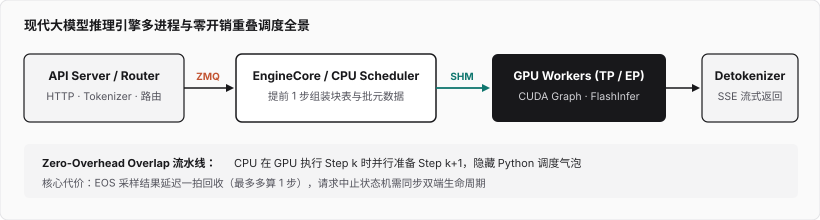

# AI Infra 技术手册

本手册聚焦大模型推理引擎、GPU 算子优化与后训练系统的底层物理约束与工程权衡，采用极简三栏工程文档结构组织。

## 知识库导航

| 模块 | 核心覆盖内容 | 入口 |
| :--- | :--- | :--- |
| **物理本质与调度循环** | Prefill / Decode Roofline 边界、KV 显存公式、Continuous Batching、Chunked Prefill 与零开销重叠调度 | [阅读本章](inference/roofline-and-batching.md) |
| **KV 缓存与 CUDA Graph** | PagedAttention 页表映射、RadixAttention 前缀树、GQA / MLA 压缩与 vLLM V1 分段 CUDA Graph | [阅读本章](inference/kv-cache-and-cudagraph.md) |
| **P/D 分离与生产排障** | DistServe 集群分离、Push 型 RDMA 传输、Deferred Release 竞态隔离与 ZMQ 控制面尾延迟观测 | [阅读本章](inference/pd-disaggregation.md) |
| **GPU 显存层次与 Tiling** | HBM / L2 / SRAM 访存带宽、Online Softmax 与 FlashAttention 访存复杂度、Small-M GEMM Tiling | [阅读本章](kernels/gpu-memory-and-tiling.md) |

## 编写约定

- **中英文与数字混排**：严格在中英文及中文与数字间保留半角空格，代码标识符使用行内代码，数学关系使用 LaTeX 公式。
- **物理约束优先**：每个系统机制均按「核心痛点 → 数学直觉与维度 → 工程权衡 → 边界与坑点」展开，不堆砌营销式概述。
