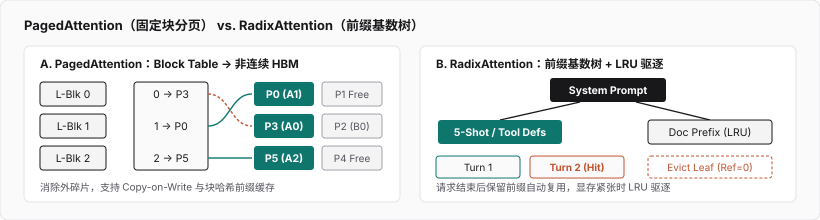

# KV 缓存与 CUDA Graph

KV Cache 内存管理的核心矛盾在于**动态变长序列造成的外碎片**与**多轮对话 / Agent 场景下的跨请求前缀复算**；而执行层的核心矛盾在于**小 Batch Decode 下的 Python / CUDA Kernel Launch 开销**。

## 1. PagedAttention vs. RadixAttention

- **[PagedAttention](https://arxiv.org/abs/2309.06180)**：借鉴操作系统虚拟内存分页，将 KV 切分为固定大小的 Block（如 16 Tokens），通过 Block Table 映射到非连续物理 HBM 块，消除外碎片并带来 2–4× 吞吐增益；在 [vLLM V1](https://vllm.ai/blog/2025-01-27-v1-alpha-release) 中结合块内容哈希实现零开销自动前缀缓存（APC）。
- **[RadixAttention](https://arxiv.org/html/2312.07104v2)**：以 Token 级基数树（Radix Tree）统一管理 KV 槽位。请求结束后不立即释放 KV，而是保留在树中供后续多轮对话、Few-shot 或 Agent 工具调用零拷贝复用；仅当显存紧张时，按 LRU 递归驱逐引用计数为 0 的叶节点。

## 2. vLLM V1 与 SGLang 核心子系统对照

| 子系统维度 | [vLLM V1](https://vllm.ai/blog/2025-01-27-v1-alpha-release) | [SGLang](https://arxiv.org/html/2312.07104v2) |
| :--- | :--- | :--- |
| **KV 内存与前缀复用** | 固定块分页 + 块哈希 APC，支持 Copy-on-Write | Token 级 Radix Tree 动态分裂 + LRU 叶节点驱逐 |
| **CUDA Graph 捕获策略** | [CUDA Graphs](https://docs.vllm.ai/en/stable/design/cuda_graphs/) 解耦编译与捕获：纯 Decode 走 **Full**，混合/Prefill 走 **Piecewise**（跳过动态 Attention 算子） | 针对离散 Batch Size 预捕获 Decode Graph，通过捕获预算平衡显存占用与 Padding 损耗 |
| **路由与约束解码** | 统一多模态与 Chunked Prefill 调度，生态模型覆盖广 | 原生压缩 FSM（XGrammar）加速 JSON 约束解码；独立 Rust 路由 [sglang-router](https://pypi.org/project/sglang-router/0.1.9/) 支持 Cache-Aware 负载均衡 |

## 3. CUDA Graph 捕获预算与工程权衡

!!! note "Piecewise vs. Full CUDA Graph"
    当批内仅含纯 Decode 请求时，Full CUDA Graph 将整层前向录制成单次图回放，CPU Launch 开销几乎归零；但在 Chunked Prefill 混合批中，Attention 算子输入形状高度动态，vLLM V1 采用 **Piecewise CUDA Graph**，仅把线性层、Norm 与激活等静态子图录制进图内，将 Attention 留在图外动态派发。

- **显存挤占风险**：每多捕获一个离散 Batch Size 都会增加静态图激活显存与私有池占用，直接压缩可用 KV Cache 容量。
- **Padding 损耗**：离散捕获点间隔过粗会导致实际 Batch 被向上补齐（Padding），造成不必要的 Small-M GEMM 计算浪费。
