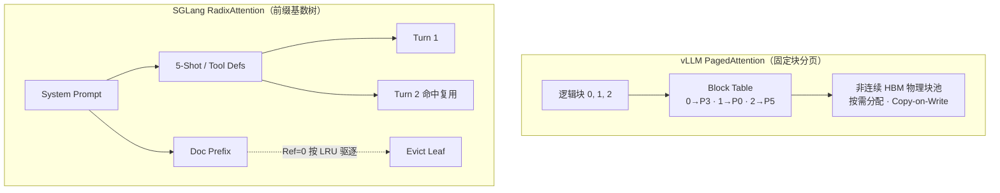

# 02. KV 缓存、MLA 与 CUDA Graph

如果说调度器决定了 GPU 能不能「一直有活干」，那么 **KV 内存抽象** 与 **CUDA Graph** 就决定了单卡能「同时接多少并发」以及「单步开销能压到多低」。

## 1. PagedAttention vs. RadixAttention

### 1.1 面试高频追问：PagedAttention 彻底消除了所有碎片吗？

- **消除了外部碎片（External Fragmentation）**：逻辑连续、物理离散，不再需要按 `max_model_len` 预分配整块连续显存（[PagedAttention, SOSP 2023](https://arxiv.org/abs/2309.06180) 实测吞吐提升 2–4×）。
- **仍存在少量内部碎片（Internal Fragmentation）**：每个序列最后一个未填满的 Block 平均浪费 `block_size / 2` 个 Token 槽位。`block_size` 通常选 16 或 32——太小会导致 Block Table 寻址与内核访存不连续开销增加，太大则内部碎片比例上升。
- **Copy-on-Write（写时复制）**：Beam Search 或 Parallel Sampling（`n > 1`）共享前缀物理块，仅在生成分叉 Token 写入最后一个块时才按需拷贝。

### 1.2 面试高频追问：vLLM APC（块哈希） vs. SGLang RadixAttention（基数树）怎么选？

| 维度 | vLLM V1 APC（Automatic Prefix Caching） | SGLang RadixAttention |
| :--- | :--- | :--- |
| **索引粒度** | **Block 级**（如 16 Tokens），对完整块计算前向链式哈希 `hash(prev_hash, block_tokens)` | **Token 级**（Radix Tree 边可动态分裂，支持任意长度前缀命中） |
| **驱逐策略** | 零引用块放入空闲队列按 LRU 复用（[vLLM V1 Blog](https://vllm.ai/blog/2025-01-27-v1-alpha-release)） | 递归按 LRU 驱逐引用计数 `lock_ref == 0` 的叶节点（[SGLang Paper](https://arxiv.org/html/2312.07104v2)） |
| **路由协同** | 依赖上层网关做前缀路由 | 原生配合 Rust 编写的 [sglang-router](https://pypi.org/project/sglang-router/0.1.9/) 做近似 Radix Tree 的 Cache-Aware 负载均衡 |
| **工程权衡** | 哈希表 $O(1)$ 查找实现极简、零树分裂锁开销；但不足一个 Block 的尾部前缀无法复用 | 多轮对话、Agent 工具调用与树状思维链命中率更高；但树维护与分裂在超高 QPS 下需精细控制 CPU 开销 |

## 2. MHA → GQA → MLA（DeepSeek 架构必考）

面试官问国产推理卡如何压降 90% 成本时，**MLA（Multi-Head Latent Attention）**几乎是必考题：

1. **核心机制**：不再缓存高维 $K, V \in \mathbb{R}^{n_h \cdot d_h}$，而是通过下投影矩阵 $W^{DKV}$ 将隐状态压缩为极低维的联合潜变量 $c_t^{\text{KV}} \in \mathbb{R}^{d_c}$（例如 $d_c = 512 \ll 2 n_h d_h$），KV Cache 只存 $c_t^{\text{KV}}$ 和极小维度的解耦 RoPE 向量 $k_t^R$。
2. **矩阵吸收（Matrix Absorption）推理加速**：
   Decode 阶段若先解压 $K = c^{\text{KV}} W^{UK}$ 会产生巨量中间显存；工程上利用结合律将上投影矩阵吸收到 $Q$ 与输出矩阵中：
   $$
   q_t^\top (W^{UK} c_j^{\text{KV}}) = \underbrace{(q_t^\top W^{UK})}_{\tilde{q}_t^\top \text{ (预先融合)}} c_j^{\text{KV}}
   $$
   从而 Attention 直接在低维潜空间计算，既把 KV Cache 显存压降了一个数量级，又大幅提高了 Decode 阶段的算术强度。

## 3. CUDA Graph 深度剖析（Full vs. Piecewise）

### 3.1 为什么 Decode 离不开 CUDA Graph？

小 Batch Decode 时，单层线性算子在 GPU 上可能只跑 10–30 μs，而 Python 逐算子调用 PyTorch Dispatch + CUDA Driver `cudaLaunchKernel` 的 CPU 耗时往往高达 20–50 μs，导致 GPU 大量时间在等 CPU 发指令（**Launch-Bound**）。CUDA Graph 将一整段算子序列及其依赖关系录制为静态图，运行时 CPU 只需一次 `cudaGraphLaunch` 即可触发整张计算图。

### 3.2 vLLM V1 的 Full vs. Piecewise CUDA Graph

根据 [vLLM CUDA Graphs 官方设计文档](https://docs.vllm.ai/en/stable/design/cuda_graphs/)，vLLM V1 将编译（`torch.compile`）与捕获解耦，支持运行时按批构成动态分发：

- **Full CUDA Graph**：适用于纯 Decode（Uniform Decode）批，整个前向（含 Attention）全部在图内，CPU 开销最低。
- **Piecewise CUDA Graph**：适用于 Chunked Prefill / 混合批，因为变长 Prefill 的 Attention 算子难以静态捕获，引擎将计算图在 Attention 处切开——**Linear / RMSNorm / RoPE / MLP 走图内回放，仅 Attention 在图外动态执行**。

### 3.3 捕获预算权衡（衔接你的 GraphBudget 项目）

- **显存预算**：每个捕获的 Batch Size 都需要静态保留中间激活显存；捕获点过多会直接吃掉 KV Cache 物理块，降低最大并发。
- **Padding 损耗**：捕获点太稀疏（如仅 1, 8, 32, 64），当实际 Batch 为 9 时必须补齐到 32，产生大量无效计算。
- **启动耗时**：线上弹性扩容（Cold Start）时，捕获几十个图会带来数十秒的冷启动延迟。
