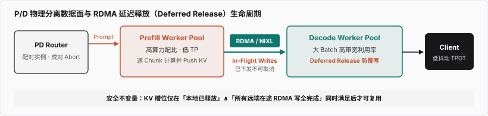

# P/D 分离与生产排障

当集群规模扩大且长上下文与严苛 TPOT SLO 并存时，单节点 Chunked Prefill 仍受限于共享 HBM 带宽与统一并行度。[DistServe](https://arxiv.org/abs/2401.09670) 将 Prefill 与 Decode 物理拆至独立 GPU 池，通过 NVLink / RDMA / NIXL 跨节点传输 KV Cache。

## 1. Push 型 RDMA 传输的关键安全不变量

在 [LMSYS 2026-10-26 工程报告](https://www.lmsys.org/blog/2026-10-26-cf-security/) 披露的 P/D 分离生产案例中，请求异常中止会暴露一类极隐蔽的内存生命周期竞态：

1. **已下发网卡的 RDMA 写不可撤回**：SGLang 采用 Push 型分块 RDMA 传输以实现计算-通信重叠，窗口长度随 Prompt 长度线性拉长。
2. **两阶段释放条件（Deferred Release）**：Decode 侧的 KV 槽位只有在「本地逻辑已释放」**且**「所有指向该地址的远端在途 RDMA 写全部完成」两个条件同时成立后，才允许重新分配给新请求，否则迟到写入会静默污染新会话输出。
3. **Router 成对中止（Paired Abort）**：中止信号必须由 Router 同时通知 Prefill 与 Decode 双方，避免单侧空等数百秒直至超时。

## 2. 生产级工程调优清单

| 排障维度 | 核心不变量 / 调优手段 | 典型失效现象 |
| :--- | :--- | :--- |
| **P/D 准入校验** | 部署前强校验 `max_context_length <= prefill_kv_pool_capacity`，被拒请求禁止进入跨节点交接 | 请求超出 KV 池容量后仍进入 Decode 读取未初始化页 |
| **Chunked Prefill 预算** | 围绕硬件 $I_{\text{ridge}}$ 实测标定 `max_num_batched_tokens` | 过小导致 TTFT 劣化；过大导致并发 Decode TPOT P99 飙升 |
| **CUDA Graph 显存预算** | 限制离散捕获点数，避免静态图显存池挤占 KV Cache 块数 | 高并发下频繁触发 KV 抢占（Preemption）与重算 |
| **跨进程 IPC 尾延迟** | 在 `Scheduler → Detokenizer → Router` 的 ZMQ 消息头注入单调时钟戳 | 纯 GPU Profiling 显示空闲，但端到端延迟居高不下 |
