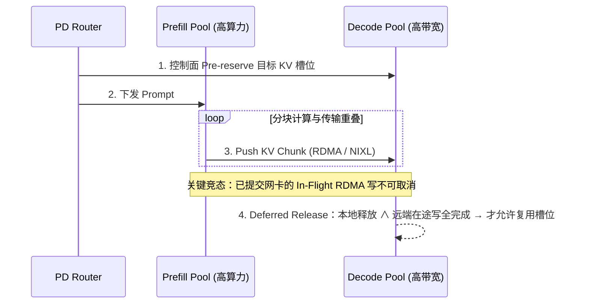

# 03. P/D 分离与国产芯片适配

本章直接对应曦望（Sunrise）大模型推理引擎岗位的两大核心业务场景：**大规模集群 P/D 分离部署**与**国产 GPGPU 硬件软件栈适配**。

## 1. 为什么单节点 Chunked Prefill 在大规模集群会失效？

即使启用了 Chunked Prefill，Prefill 与 Decode 在同一张卡上混跑仍有三个无法根除的矛盾（[DistServe, OSDI 2024](https://arxiv.org/abs/2401.09670)）：

1. **并行策略冲突**：Prefill 偏好较小 TP 或 PP 以减少通信占比、压低 TTFT；Decode 偏好较大 DP + 大 Batch（甚至 MoE 下的 Expert Parallelism）以最大化 HBM 带宽利用率。
2. **HBM 带宽争抢**：Chunked Prefill 每次切块仍要重读前缀 KV，在高并发长上下文下会持续挤占 Decode 的带宽窗口。
3. **异构硬件无法匹配**：Prefill 需要高算力卡（Compute-heavy），Decode 更看重高显存容量与高 HBM 带宽（Memory-heavy）；P/D 分离后允许两池使用不同配比甚至不同型号的推理卡。

## 2. P/D 分离数据面与 RDMA 生命周期竞态

### 生产级高危故障复盘（面试加分杀手锏）

结合 [LMSYS 2026-10-26 安全与隔离更新](https://www.lmsys.org/blog/2026-10-26-cf-security/) 披露的真实生产事故，答出以下三点能让面试官立刻看出你的生产级工程视野：

1. **准入边界校验**：必须确保 `max_context_length <= prefill_kv_pool_capacity`，且被拒绝的请求必须在进入 P/D 跨节点交接前即返回错误，严禁让 Decode 读取未初始化的 KV 页。
2. **Deferred Release（延迟释放）**：在 Push 型分块 RDMA 传输中，如果客户端中途断开（Abort），已下发给 NIC 的 RDMA Write 无法撤回。Decode 分配器判断一个槽位「真正空闲（Free）」必须同时满足两个条件：**本地已释放** + **无任何远端在途写（In-Flight Writes）可触达该地址**，否则迟到写入会静默覆写新用户的 KV Cache。
3. **Router 成对中止（Paired Abort）**：中止必须由 Router 同时通知 Prefill 与 Decode 双方，否则对端会傻等数百秒直至超时，拖垮整个连接池。

## 3. 国产 GPGPU（曦望 S2/S3 · CUDA 兼容 · FlagOS）适配核心挑战

!!! note "为什么面试官一定会问这个问题"
    曦望的核心竞争力在于「兼容 CUDA 生态 + 深度参与 FlagOS 2.0（FlagTree / FlagGems / vLLM / SGLang）」，推理引擎研发工程师每天面对的真实业务问题，就是**如何让主流开源大模型在自研芯片上 Day-0 跑通、跑准、跑快**。

| 适配层级 | 常见痛点与故障模式 | 工程解法与落地方案 |
| :--- | :--- | :--- |
| **1. Attention 后端移植** | FlashAttention / FlashInfer 依赖大量 NVIDIA PTX 汇编与特定 SM 架构（如 TMA / WGMMA），在非 NV 芯片或新架构上无法直接编译 | 通过插件化后端机制（如 `vllm-plugin-FL`）对接自研高效 Attention；同时确保 **Generic Math SDPA Fallback** 路径 100% 正确（如你修复的 `FlagGems #9124` GQA 支持），保证新模型 Day-0 可跑通与精度基线对齐 |
| **2. Triton / FlagTree 编译** | 不同硬件的 SRAM 容量、Warp/Wavefront 大小、寄存器文件数不同，直接照搬 NVIDIA 的 `BLOCK_M/N/K` 会导致严重 Register Spilling 或 Shared Memory OOM | 借助 [FlagTree](https://github.com/flagos-ai/flagtree) 多后端编译器，建立按硬件 Profile 自动寻优的 Autotune Config，避免硬编码 SM 参数 |
| **3. 静态图（CUDA Graph）适配** | 国产驱动/运行时对 Graph Capture 中动态内存分配、多 Stream Event 同步或自定义通信算子的兼容性边界较敏感 | 优先打通纯 Decode Full Graph，混合批采用 Piecewise Graph 将高风险算子留在图外；建立逐算子 Capture 冒烟测试 |
| **4. 精度对齐与数值漂移** | BF16/FP16 累加顺序差异、整数比较/类型隐式转换差异、长序列 `int32` 索引溢出 | 建立「CPU FP32 Golden Reference → 逐层 Cosine Similarity & Max Abs Diff → 端到端 Logprobs 对比」自动化验收流水线 |
| **5. 算子覆盖与性能归因** | 某些冷门算子意外 Fallback 到 PyTorch CPU 或未融合的小算子，拖垮整条推理链路 | 通过 Profiler + Roofline 模型区分 Compute-bound / Memory-bound / Launch-bound，优先融合热点访存算子（RMSNorm、RoPE、SwiGLU、KV Cache Write） |
