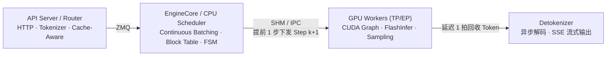

# 物理本质与调度循环

自回归大语言模型（Autoregressive LLM）的单次请求由 **Prefill（预填充）** 与 **Decode（解码）** 两个阶段构成。两者共享同一套模型权重，却落在 GPU Roofline 曲线的截然两端。

## 1. Prefill 与 Decode 的硬件撕裂

| 维度 | Prefill（预填充） | Decode（解码） |
| :--- | :--- | :--- |
| **算子形态与张量维度** | GEMM：`[B·S, d] × [d, d_out]` | GEMV / Small-M GEMM：`[B, d] × [d, d_out]` |
| **主导硬件瓶颈** | Compute-Bound（Tensor Core 峰值算力） | Memory-Bandwidth-Bound（HBM 权重 + KV 带宽） |
| **核心 SLO 指标** | **TTFT**（Time to First Token） | **TPOT**（Time Per Output Token） |
| **并行度偏好** | 低 TP 降低跨卡 AllReduce 通信 | 大 Batch / 高 DP 摊薄全量权重读取 |

## 2. 三个核心数学不变量

### 2.1 单 Token KV Cache 显存占用

$$
M_{\text{KV}} = 2 \cdot L \cdot n_{\text{kv}} \cdot d_h \cdot p
$$

其中 $L$ 为 Transformer 层数，$n_{\text{kv}}$ 为 KV 头数，$d_h$ 为单头维度，$p$ 为精度字节数（BF16 为 2 Bytes，FP8 为 1 Byte）。

- **GQA（Grouped-Query Attention）** 通过缩减 $n_{\text{kv}}$ 线性压缩 KV 显存。
- **MLA（Multi-Head Latent Attention）** 通过低秩投影仅缓存压缩潜变量 $c_{\text{KV}}$，进一步降低长上下文带宽压力。
- 集群单节点最大并发 $B_{\max}$ 直接受限于剩余显存 $M_{\text{avail}} / (\bar{S} \cdot M_{\text{KV}})$。

### 2.2 BF16 Decode 算术强度与临界批大小

忽略激活值与历史 KV 读取时，每生成 1 个 Token 的前向计算量约为 $2 \cdot B \cdot W$ FLOPs，权重访存量约为 $2 \cdot W$ Bytes（$W$ 为参数量），故 Decode 算术强度与临界批大小满足：

$$
I_{\text{decode}} \approx \frac{2 \cdot B \cdot W}{2 \cdot W} = B, \qquad B^* \approx \frac{I_{\text{ridge}}}{2} = \frac{\text{Peak FLOPs}}{2 \cdot \text{HBM BW}}
$$

当 $B \ll B^*$ 时 GPU 处于严重的带宽受限区；而在超长上下文场景下，历史 KV 搬运量 $B \cdot S \cdot M_{\text{KV}}$ 会超过静态权重 $2W$，Attention 访存成为绝对瓶颈。

### 2.3 Goodput（有效吞吐）

生产推理系统的优化目标并非裸 Tokens/s，而是最大化**同时满足 TTFT 与 TPOT 双重 SLO** 的有效请求速率，这一框架由 [DistServe](https://arxiv.org/abs/2401.09670) 正式确立。

## 3. 多进程解耦与零开销重叠调度

现代推理引擎（[vLLM V1 架构](https://docs.vllm.ai/en/stable/design/arch_overview/)、[SGLang](https://arxiv.org/html/2312.07104v2)）将 HTTP 接入、分词、调度控制面与 GPU 执行面拆分为独立进程，并通过 CPU 提前 1 步组装元数据来隐藏 Python 控制面气泡：

## 4. 三大调度范式演进与权衡

| 调度范式 | 代表系统 | 核心机制 | 工程权衡 |
| :--- | :--- | :--- | :--- |
| **连续批处理**（Continuous Batching） | [Orca](https://www.usenix.org/conference/osdi22/presentation/yu) | 迭代级调度，每步生成 1 个 Token 后即时回收已完成请求的 KV 并合入新请求 | 消除静态批木桶效应，但长 Prefill 仍阻塞同批 Decode |
| **分块预填充**（Chunked Prefill） | [Sarathi-Serve](https://arxiv.org/abs/2403.02310) | 按固定 Token 预算切分长 Prompt，与在途 Decode 拼成混合批（Stall-free） | 显著压低 TPOT P99 毛刺，但每个 Chunk 需重读前缀 KV，存在带宽折损 |
| **零开销重叠调度**（Overlap Scheduling） | [vLLM V1](https://vllm.ai/blog/2025-01-27-v1-alpha-release) · [SGLang](https://arxiv.org/html/2312.07104v2) | CPU 线程领先 GPU 一个迭代周期，异步下发下步索引与块表 | 彻底消除小模型与高并发下的 CPU-bound 气泡；代价是 EOS 最多多算 1 步且中止状态机更复杂 |
