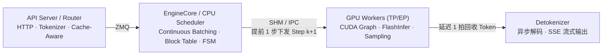

# 01. 物理边界、手算算例与调度循环

大模型推理引擎的一切设计，本质上都是在**硬件算力（FLOPs）、显存带宽（HBM BW）与显存容量（VRAM）**三者构成的三角约束内做极致压榨。

## 1. Prefill 与 Decode 的物理撕裂

| 维度 | Prefill（预填充） | Decode（解码） |
| :--- | :--- | :--- |
| **输入张量形态** | `[B · S, d_model]`（整段 Prompt 并行） | `[B, d_model]`（每请求仅 1 个新 Token） |
| **线性层算子形态** | 大矩阵 GEMM：`[B·S, d] × [d, d_out]` | GEMV / Small-M GEMM：`[B, d] × [d, d_out]` |
| **主导硬件瓶颈** | **Compute-Bound**（Tensor Core 峰值算力） | **Memory-Bandwidth-Bound**（HBM 权重 + KV 带宽） |
| **核心业务 SLO** | **TTFT**（首字延迟） | **TPOT**（单 Token 生成间隔，决定流式手感） |
| **并行度偏好** | 适度 TP 降低单请求 TTFT | 大 Batch / 高 DP 摊薄全量权重读取，减少跨卡 AllReduce |

## 2. 面试必考手算真题（以 Llama-3-70B + 80 GB 推理卡为例）

!!! question "面试官常见原题"
    给你 1 张 80 GB 显存、BF16 算力 312 TFLOP/s、HBM 带宽 2.0 TB/s 的推理卡（如 A100 / 启望 S2 级别），或者 4 卡部署 **Llama-3-70B（BF16）**：请现场估算权重显存、单 Token KV 显存、最大并发 Batch Size 以及 Decode 理论最快 TPOT。

### 2.1 给定模型与硬件参数

- **模型（Llama-3-70B）**：参数量 $W \approx 70\text{B}$，层数 $L = 80$，Query 头数 $n_q = 64$，GQA KV 头数 $n_{\text{kv}} = 8$，单头维度 $d_h = 128$，精度 BF16（$p = 2\text{ Bytes}$）。
- **硬件假设（以单卡 A100-80GB SXM 为基准，4 卡 TP=4）**：单卡 80 GB VRAM，BF16 峰值 $312\text{ TFLOP/s}$，HBM 带宽 $2.0\text{ TB/s}$。

### 2.2 逐步推导

1. **静态权重显存**：
   $$
   M_{\text{weight}} = 70 \times 10^9 \times 2\text{ B} = 140\text{ GB} \implies \text{TP=4 时单卡权重 } 35\text{ GB}
   $$
   扣除激活值、CUDA Context 与 CUDA Graph 静态池（约预留 10 GB），单卡可用于 KV Cache 的显存约 $M_{\text{avail}} \approx 35\text{ GB}$，4 卡总可用 KV 显存约 $140\text{ GB}$。

2. **单 Token KV Cache 显存**：
   $$
   M_{\text{KV}} = 2 \cdot L \cdot n_{\text{kv}} \cdot d_h \cdot p = 2 \times 80 \times 8 \times 128 \times 2\text{ B} = 327{,}680\text{ B} = 320\text{ KB / token}
   $$
   - 对比：若无 GQA（MHA $n_{\text{kv}} = 64$），单 Token 高达 **2.5 MB**，GQA 直接节省 **8×** 显存与 KV 带宽。
   - 若平均序列长度 $\bar{S} = 4096$ Tokens，单请求 KV 占用 $4096 \times 320\text{ KB} = 1.25\text{ GB}$。

3. **并发上限 $B_{\max}$**：
   $$
   B_{\max} = \frac{140\text{ GB}}{1.25\text{ GB}} \approx 112\text{ 并发请求}
   $$

4. **BF16 Roofline 拐点与临界批大小 $B^*$**：
   $$
   I_{\text{ridge}} = \frac{312\text{ TFLOP/s}}{2.0\text{ TB/s}} = 156\text{ FLOPs / Byte}
   $$
   线性层每 Token 计算量约 $2W$ FLOPs，BF16 权重读取量 $2W$ Bytes，故算术强度 $I_{\text{decode}} \approx B$（忽略 KV 读取时，达到拐点需 $B^* \approx I_{\text{ridge}} = 156$；若是 FP8 权重 + BF16 算力或按双字节折算则需核对分子分母单位）。

5. **Decode 理论最快 TPOT（$B = 1$ 时）**：
   $$
   \text{TPOT}_{\min} \ge \frac{M_{\text{weight, per-GPU}}}{\text{HBM BW}} = \frac{35\text{ GB}}{2.0\text{ TB/s}} = 17.5\text{ ms / token} \quad (\text{不含 TP AllReduce 与 KV 读})
   $$
   当长上下文 $B = 32, S = 8192$ 时，每步 KV 读取量为 $32 \times 8192 \times 320\text{ KB} / 4 \approx 20\text{ GB / GPU}$，与 35 GB 权重同量级，Attention 带宽占比飙升至 ~36%。

## 3. 调度循环演进（Continuous Batching → Overlap Scheduling）



### 3.1 调度循环核心伪代码（Zero-Overhead Overlap）

```python
# SGLang / vLLM V1 零开销重叠调度核心思想（简化伪代码）
def event_loop():
    pending_result = None
    while True:
        # 1. CPU 侧在不等待上一轮 GPU 采样同步的情况下，提前组装下一批 Batch k+1
        next_batch = scheduler.get_next_batch_to_run()

        # 2. 异步向 GPU Stream 提交 Forward + Sample（不阻塞 CPU）
        if next_batch is not None:
            future_result = model_runner.forward_async(next_batch)
        else:
            future_result = None

        # 3. 此时 GPU 正在跑 Batch k+1，CPU 顺手回收 Batch k 的采样结果并流式发给 Detokenizer
        if pending_result is not None:
            token_ids = pending_result.synchronize_and_get()
            scheduler.process_batch_result(token_ids)  # 检查 EOS / 释放 KV / 推送 ZMQ

        pending_result = future_result
```

### 3.2 三大调度范式深度对照

| 调度范式 | 代表系统 | 核心机制 | 关键收益 | 工程代价与边界坑点 |
| :--- | :--- | :--- | :--- | :--- |
| **连续批处理** | [Orca](https://www.usenix.org/conference/osdi22/presentation/yu) | 迭代级（Iteration-level）动态进出批，单步结束立即释放 KV 槽位 | 彻底消除静态批处理等待最长序列的木桶效应 | 新请求的长 Prefill 会插入 Decode 之间，造成严重的 TPOT 尾延迟抖动 |
| **分块预填充** | [Sarathi-Serve](https://arxiv.org/abs/2403.02310) | 将长 Prompt 按 `max_num_batched_tokens` 切分为等长 Chunk，与在途 Decode 拼成混合批 | 消除 Decode 停顿（Stall-free），大幅压低 TPOT P99，并让 Decode 免费搭 Prefill 权重读取的便车 | 每个 Chunk 计算 Attention 时都需重读此前所有 Prefix KV，长上下文下存在 HBM 带宽放大 |
| **零开销重叠调度** | [vLLM V1](https://vllm.ai/blog/2025-01-27-v1-alpha-release) · [SGLang](https://arxiv.org/html/2312.07104v2) | CPU 调度领先 GPU 1 步，隐藏 Python 调度、块表构建与 ZMQ 通信耗时 | 小模型 / 高并发低延迟场景下消除 GPU 空泡（CPU-bound → GPU-bound） | 采样结果晚一拍得知，遇到 EOS 会多算 1 步（需丢弃冗余 Token）；中止（Abort）与抢占（Preemption）状态机更复杂 |
