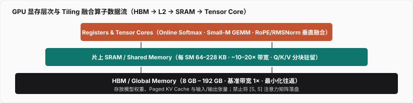

# GPU 显存层次与 Tiling 融合算子

推理引擎的上限最终落在单个 GPU 算子的访存效率上。理解 HBM、L2 Cache、片上 SRAM（Shared Memory）与 Registers 的带宽级差，是设计融合算子（Fused Kernels）与 Tiling 策略的前提。

## 1. 显存层次与访存优化铁律

| 存储层次 | 典型容量级 | 相对带宽 | 算子优化核心目标 |
| :--- | :--- | :--- | :--- |
| **HBM（Global Memory）** | 8 GB – 192 GB | 基准（1×） | 最小化读写次数、合并访存（Coalesced Access）、避免中间大张量落盘 |
| **L2 Cache** | 数 MB – 数十 MB | ~3–5× | 通过 Swizzle / Persistent Kernel 提高权重与 KV 块复命中率 |
| **SRAM / Shared Memory** | 每 SM 64 KB – 228 KB | ~10–20× | 分块驻留（Tiling）、避免 Bank Conflict、承载 FlashAttention 块计算 |
| **Registers** | 每 SM 256 KB | 最高（无延迟） | 承载 MMA 累加器与元素级融合链（RoPE / RMSNorm / SwiGLU） |

## 2. FlashAttention 与 Online Softmax 的核心直觉

标准 Attention 显式构造 $[S, S]$ 注意力矩阵 $P = \text{softmax}(QK^\top / \sqrt{d_h})$ 并写回 HBM，导致 $O(S^2)$ 显存占用与带宽瓶颈。FlashAttention 通过 **Tiling + Online Softmax** 将 $Q, K, V$ 按块加载至片上 SRAM，边遍历 $K, V$ 分块边动态维护局部最大值 $m_i$ 与归一化分母 $l_i$：

$$
m_{\text{new}} = \max(m_{\text{old}}, \tilde{m}), \qquad
l_{\text{new}} = e^{m_{\text{old}} - m_{\text{new}}} l_{\text{old}} + e^{\tilde{m} - m_{\text{new}}} \tilde{l}
$$

整个前向过程无需将 $S \times S$ 矩阵写回 HBM，把 HBM 访存量从 $O(S^2)$ 压缩至 $O(S \cdot d_h)$。

## 3. 推理算子融合与工程避坑点

- **Small-M GEMM Tiling**：Decode 阶段批大小 $B$ 往往在 1–32 之间，常规大矩阵 GEMM 的大 $M$-Tile 会导致大量线程块空转（Wave Quantization）。针对小 $M$ 定制如 `M16 / N64 / K128` 的细粒度 Tiling 可显著提升 SM 占用率。
- **访存密集算子垂直融合**：将相邻的 `RoPE + RMSNorm + Paged KV-Cache Write` 或 `Gate/Up Projection + SwiGLU` 融合为单个 Triton / CUDA Kernel，把多次 HBM 往返压成单次读写。
- **大张量索引溢出（`int32` → `int64`）**：在 GQA / 长上下文 Attention 或大批量 Reduction Kernel 中，当元素总数超过 $2^{31}-1$（约 21 亿）时，`program_id * stride` 必须显式提升至 `int64`，否则会在长序列下触发静默越界或 NaN。
